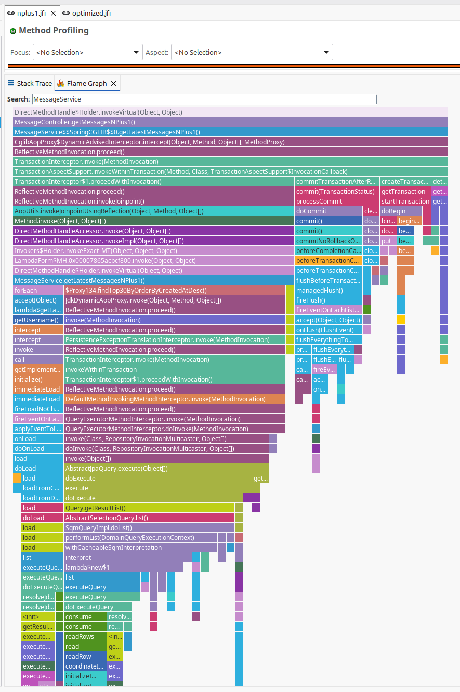
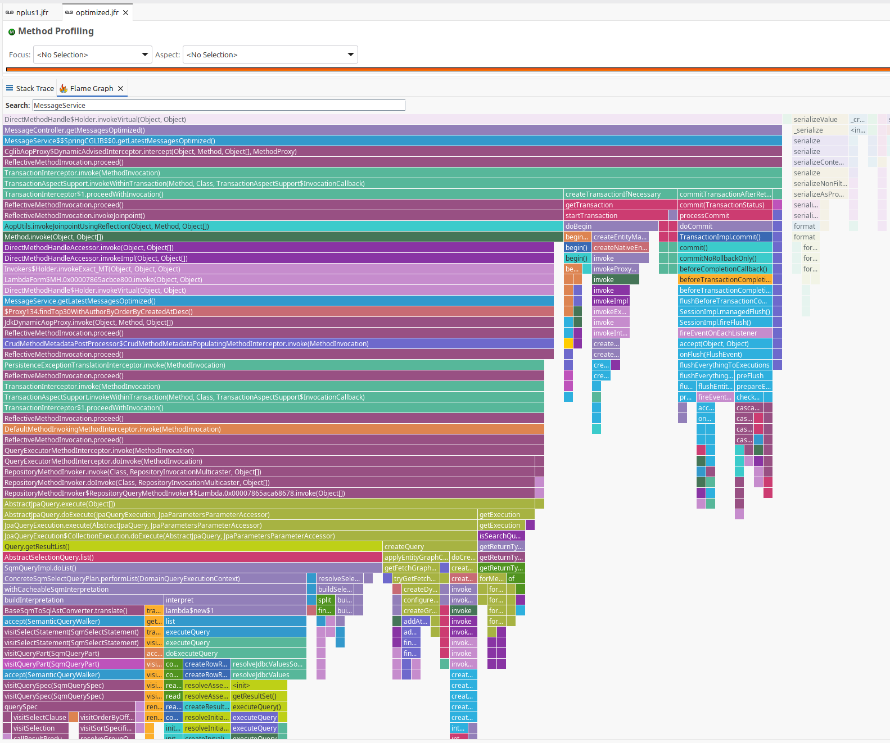

## Профилирование

Данные: 200 сообщений от 30 авторов (`./gradlew runTestDataInitializer -Pcount=200 -Pusers=30`),
поэтому среди 30 последних сообщений 30 разных авторов: `/nplus1` выполняет
1 + 30 = 31 SQL-запрос, `/optimized` — 1.
Нагрузка: по 5000 последовательных запросов curl к каждому эндпоинту.

### Результаты

| | /nplus1 | /optimized |
|---|---|---|
| Время серии из 5000 запросов (`time`, real) | 31,659 с | 31,224 с |
| CPU-замеров (Method Profiling Sample) | 137 | 133 |
| SQL-запросов на один HTTP-запрос | 31 | 1 |
| Ветка ленивой загрузки авторов в профиле | есть | нет |

**/nplus1.** Наибольшее время CPU занимает выполнение запросов Hibernate, обработка транзакции Spring и сериализация JSON (Jackson).
Во Flame Graph видна отдельная ветка проблемы N+1:
`getLatestMessagesNPlus1 → forEach → getUsername → AbstractLazyInitializer.initialize →
immediateLoad → load → executeQuery` — каждый прокси автора загружается отдельным запросом.
При фиксации транзакции (`commit → flush`) Hibernate дополнительно проверяет
на изменения все 60 загруженных сущностей (30 сообщений + 30 пользователей).

**/optimized.** Ветки ленивой загрузки нет: авторы загружаются тем же запросом
через `@EntityGraph` (JOIN). Заметную часть CPU занимает построение SQL из запроса
(`buildInterpretation → BaseSqmToSqlAstConverter.translate`) и применение графа
(`applyEntityGraph`).

### Flame Graph: /api/messages/nplus1

### Flame Graph: /api/messages/optimized

### Выводы
1. По CPU эндпоинты почти равны (137 и 133 замера). Причина — база H2 работает
   в памяти того же процесса.
2. В реальной системе с внешней СУБД каждый из 30 лишних запросов — это сетевой запрос и ответ,
   то есть время ожидания, которое CPU-профиль почти не отражает, но которое
   прямо увеличивает время ответа и нагрузку на базу. Поэтому `/optimized`
   (1 запрос вместо 31) — правильное решение, и выигрыш растёт с числом авторов
   и с сетевой задержкой до базы.
3. Наибольшее время CPU в обоих случаях занимают Hibernate (подготовка
   и выполнение запросов, flush при коммите), транзакции Spring и сериализация
   JSON в Jackson, а не код сервиса.

